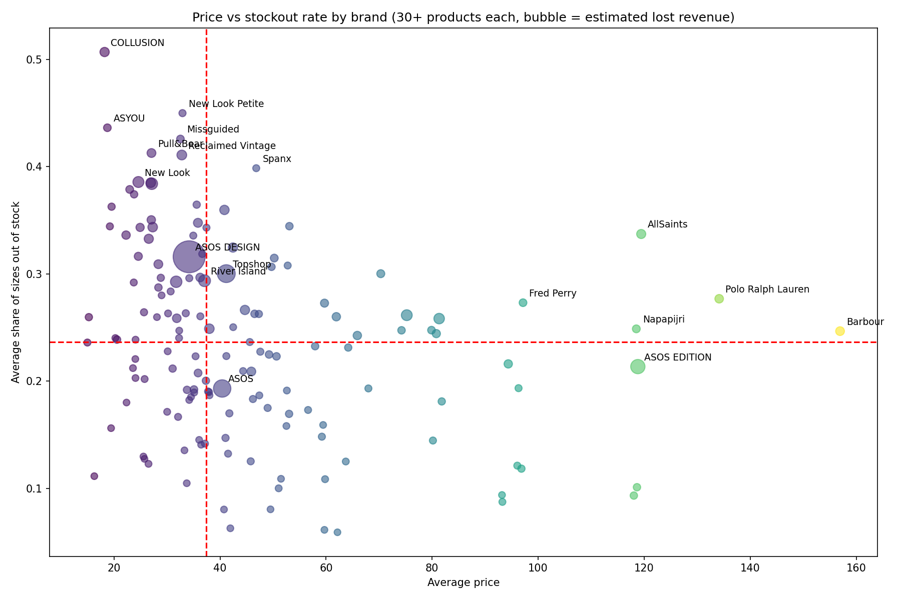

# 👗 ASOS Stockout Analysis: Brand, Price & Size Availability

_Looking at which brands run out of sizes most often, and whether price has anything to do with it, using Python._

---

## 📌 Table of Contents
- [Overview](#overview)
- [Business Problem](#business-problem)
- [Dataset](#dataset)
- [Tools & Technologies](#tools--technologies)
- [Project Structure](#project-structure)
- [Data Cleaning & Preparation](#data-cleaning--preparation)
- [Key Findings](#key-findings)
- [Chart](#chart)
- [Limitations](#limitations)
- [How to Run This Project](#how-to-run-this-project)
- [Recommendations](#recommendations)
- [Author & Contact](#author--contact)

---

## Overview

This project looks at size availability across about 30,000 ASOS product listings. For each product I counted how many sizes were marked "Out of stock", then compared brands by price and stockout rate. I also put a rough number on the revenue that missing sizes might represent.

---

## Business Problem

A product with half its sizes gone is harder to sell. The questions I wanted to answer:
- How common are stockouts across the catalogue?
- Which brands lose the most sizes?
- Do cheaper brands run out more than expensive ones?
- Are sale items more stocked out than full-price ones?
- Which brands carry the biggest estimated revenue at risk?

---

## Dataset

- `products_asos.csv`: 30,845 rows of ASOS product listings (name, sizes, price, description, colour, URL)
- Sizes are stored as one text field, with "Out of stock" written next to any size that has run out
- Source: _add your download link here_

---

## Tools & Technologies

- Python (Pandas, NumPy, Matplotlib, Seaborn)
- GitHub

---

## Project Structure

```
asos-stockout-analysis/
│
├── README.md
├── products_asos.csv
├── asos_analysis_fixed.py
├── brand_summary.csv
└── brand_strategy.png
```

---

## Data Cleaning & Preparation

- Dropped 18 empty rows.
- Fixed the price column. Sale items are stored as text like `Now  22.50`, so a plain numeric conversion turns them into blanks. My first version lost 12,449 rows (40% of the data) this way. I now pull the number out with a regex.
- Removed 359 duplicate listings by URL, which left 30,468 products.
- Found the brand by taking the text after "by" in the description and matching it against the start of the product name. This keeps names like "New Look" and "River Island" whole, without a manual mapping.
- 1,567 products had no brand I could read, so they are left out of the brand results.
- Counted stockouts as the number of "Out of stock" sizes, and stockout rate as that number divided by total sizes.
- Estimated lost revenue as price x number of out-of-stock sizes. This assumes each missing size would have sold once, so treat it as a rough guide.
- Brand comparisons only include brands with at least 30 products (149 brands).

---

## Key Findings

1. **Stockouts are common**: 55.5% of products have at least one size out of stock, and on average 27% of a product's sizes are gone. No product is fully sold out.
2. **Cheap, trend-led brands run out most**: COLLUSION has the highest rate (51% of sizes, average price 18), followed by New Look Petite (45%), ASYOU (44%), Missguided (43%) and Pull&Bear (41%).
3. **Price and stockouts are weakly linked**: across the 149 brands, the correlation is -0.27, so pricier brands tend to run out a bit less.
4. **Some premium brands are the exception**: AllSaints (34%, average price 119) and Polo Ralph Lauren (28%, average price 134) sit above the median brand rate of 24%.
5. **Biggest estimated revenue at risk**: ASOS DESIGN (about 449k), Topshop (about 127k) and ASOS (about 119k). This mostly reflects how many products they list. Per product, ASOS EDITION is highest at about 186.
6. **Sale items are not more stocked out**: 27.4% of sizes are out on sale items versus 26.9% on full-price ones. A slightly higher share of sale items has at least one size gone (58% vs 54%).

---

## Chart



Each bubble is a brand. The red lines mark the median price and median stockout rate. Bubble size shows estimated lost revenue.

---

## Limitations

- Estimated lost revenue assumes one lost sale per missing size. Real demand will differ.
- The data is a single snapshot, so it can't show how long a size stayed out of stock.
- Brand names come from text parsing, so a few may still be cut or grouped wrongly.
- Stock status says nothing about whether the item was popular or just had low stock to begin with.

---

## How to Run This Project

1. Clone the repository:
```bash
git clone https://github.com/Arnab-710/asos-stockout-analysis.git
```
2. Install the libraries:
```bash
pip install pandas numpy matplotlib seaborn
```
3. Run the analysis (keep `products_asos.csv` in the same folder):
```bash
python asos_analysis_fixed.py
```
4. Check `brand_summary.csv` and `brand_strategy.png` for the results.

---

## Recommendations

- Look at stock levels for the high-stockout, low-price brands first, since they lose the most sizes.
- Check whether AllSaints and Polo Ralph Lauren are under-stocked, because they run out more than other premium brands.
- Track stockouts over time, not just once, to see which sizes go first.

---

## Author & Contact

**Arnab Kar**

📧 Email: arnabk734@gmail.com
🔗 [LinkedIn](https://www.linkedin.com/in/arnab-kar10/)
💻 [GitHub](https://github.com/Arnab-710)
